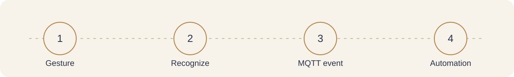

# PyPotter

Turn wand gestures into smart home actions. PyPotter recognizes trained spells, records casts in a local web app, and can publish spell events to Home Assistant through MQTT.

This is a fork of [Adam Thole's original PyPotter](https://github.com/adamthole/PyPotter). The original camera workflow remains available alongside the newer web app.

**Start here:** [Run locally](#run-locally) · [Train a spell](#train-a-spell) · [Connect Home Assistant](#connect-home-assistant) · [Use Docker](#use-docker) · [Project notes](#project-notes)

## What you can do

| | |
| --- | --- |
| **Cast** | Select a trained spell or upload a wand path image to test recognition. Recent casts stay visible after a reload. |
| **Train** | Draw with a mouse or finger, or upload PNG/JPEG examples. Create custom spells from the web app. |
| **Automate** | Enable MQTT discovery to expose spell triggers and sensors to Home Assistant. |
| **Keep the camera workflow** | Run the original OpenCV script on a host with a camera and GUI support. |

## Run locally

You need Python 3.12, 3.13, or 3.14 and [uv](https://docs.astral.sh/uv/). Python 3.14 is the primary runtime.

```bash
uv sync --extra dev
uv run pypotter web
```

Open **<http://127.0.0.1:8000>**. The web app is designed for one person on a trusted local machine. It stores cast history in SQLite; no account setup is required.

## Train a spell

1. Open **Train a gesture** and choose an existing spell or **Create a new spell**.
2. Draw a wand path or upload PNG/JPEG images of one.
3. Save 1 to 5 examples at a time. Add a few natural variations to improve recognition.
4. Under **Start a cast**, upload a wand path image to test it.

Saved examples are available to image recognition immediately. Selecting a spell by name casts it directly, without testing its gesture.

Training images are stored in `Training/<spell_name>/` by default. Set `PYPOTTER_TRAINING_DIR` to move them. Custom names use lowercase letters, numbers, and underscores internally: `Lumos Maxima` becomes `lumos_maxima`.

## Connect Home Assistant



When MQTT is enabled, PyPotter publishes spell events to `pypotter/events` and a retained discovery message to `homeassistant/device/pypotter/config`. Home Assistant discovers a PyPotter device with a **Last spell** sensor, a confidence sensor, and a trigger for each trained spell, including custom spells.

1. Connect PyPotter and [Home Assistant's MQTT integration](https://www.home-assistant.io/integrations/mqtt) to the same broker.
2. Set these values in `.env` (or your deployment environment):

   ```dotenv
   PYPOTTER_ENABLE_MQTT=true
   PYPOTTER_MQTT_HOST=your-broker-host
   PYPOTTER_MQTT_PORT=1883
   PYPOTTER_MQTT_USERNAME=your-username
   PYPOTTER_MQTT_PASSWORD=your-password
   PYPOTTER_MQTT_DISCOVERY_PREFIX=homeassistant
   PYPOTTER_MQTT_TOPIC_PREFIX=pypotter
   PYPOTTER_MQTT_CLIENT_ID=pypotter
   ```

3. In a Home Assistant automation, choose the discovered **PyPotter** device and a spell trigger, such as `spell_cast / incendio`.

The automation can control a Home Assistant entity or send an [`mqtt.publish` action](https://www.home-assistant.io/actions/mqtt.publish/) to another device. This MQTT path does not need a Home Assistant REST token. PyPotter republishes discovery when it receives Home Assistant's MQTT birth message.

An event looks like this:

```json
{"spell":"incendio","confidence":1.0,"source":"spell","created_at":"2026-01-01T00:00:00+00:00"}
```

To watch events directly, subscribe to `pypotter/#` with an MQTT client. For example, with `mosquitto_sub`:

```bash
mosquitto_sub -h your-broker-host -p 1883 -u your-username -P your-password -t 'pypotter/#' -v
```

The Compose project includes an Eclipse Mosquitto broker for local development. Its host port binds to `127.0.0.1:1883` by default. Configure broker credentials or point PyPotter at an existing authenticated broker, and connect Home Assistant to that same broker. Broker data lives in the `mqtt-data` volume.

## Use Docker

```bash
docker compose up --build
```

Open **<http://127.0.0.1:8000>**. The image serves the compiled frontend through FastAPI, runs as a non-root user, and stores SQLite data at `/data/pypotter.db`. Keep the `pypotter-data` volume to preserve cast history and trained gestures. In Docker, training images live at `/data/Training`.

The camera script runs separately from the web container. Use a camera-capable host for the original OpenCV workflow; it is not started by Compose.

## Run on constrained hardware

Use `pypotter web` or the supplied Docker entry point to enable MQTT lifecycle control. Publish a command to `pypotter/edge/set` at QoS 1 with the topic prefix configured for PyPotter.

| Command | What runs |
| --- | --- |
| `ON` | Web UI, recognition and training API, and MQTT spell events |
| `HEADLESS` | Recognition and training API, and MQTT spell events |
| `OFF` | The HTTP worker exits, releasing its memory and closing the port. MQTT wake control remains available. |

`pypotter/edge/state` reports the selected mode as a retained message, or `ERROR` if the worker exits unexpectedly and `UNAVAILABLE` when the listener is offline. Use `/ready` for HTTP readiness after waking. Repeating the current mode leaves the worker running. Use a retained command to restore the selected mode on reconnect or restart. Set `PYPOTTER_EDGE_MODE=off` to start asleep. The controller uses the configured MQTT credentials with `-edge` appended to its client ID. Restrict who can publish to the command topic in the broker ACL.

On a small Linux machine, use one PyPotter instance and an existing MQTT broker. The worker admits one recognition or training request at a time, bounds image dimensions before decoding, and caches up to 512 normalized samples in about 1.25 MiB of pixel data. Larger corpora are read in batches. Training through the API refreshes that cache. Restart the worker after editing corpus files directly. Routine HTTP access logs are off by default. Set `PYPOTTER_ACCESS_LOG=true` to enable them.

The standalone IR camera script runs independently of the web worker. Use a low resolution camera stream, disable preview windows on a headless host, and use the brightness threshold alone if background subtraction is unnecessary. The pinned OpenCV package includes a Linux ARM64 wheel. Verify dependency availability separately for 32-bit ARM.

## CLI, API, and migration

The original entry point is still available:

```text
python PyPotter.py [video source] [Home Assistant URL] [API token] [remove background] [show windows] [training] [debug FPS]
```

The historical `PyPotter`, `HassApi`, and `CountsPerSec` modules remain importable. For the modern CLI:

```bash
uv run pypotter recognize incendio
uv run pypotter migrate
```

The FastAPI application factory is `pypotter.api.app:create_app`. Health checks are at `/health` and `/ready`; application routes are under `/api/v1`. See the checked-in [OpenAPI contract](openapi.json) for request and response details.

Copy [`.env.example`](.env.example) to `.env` to configure PyPotter. Settings use the `PYPOTTER_` prefix. Home Assistant REST calls and MQTT publishing are disabled by default.

The original project has a `Training/` image corpus and no database format. `pypotter migrate` creates the SQLite schema without changing those images. Back up an existing database before migration; `pypotter.migration.backup_database` creates a timestamped copy.

## Project notes

| Area | Location |
| --- | --- |
| Spell concepts | `pypotter/domain` |
| Recognition and training | `pypotter/services` |
| SQLAlchemy repository and SQLite | `pypotter/persistence` |
| MQTT and Home Assistant | `pypotter/integrations` |
| FastAPI adapters | `pypotter/api` |
| React and TypeScript client | `frontend/` |

The web release is local and unauthenticated. Use it on a trusted machine or network. It does not stream the camera in the browser. The original OpenCV pipeline needs a camera-capable host and GUI support when preview windows are enabled.

### Development

```bash
uv sync --extra dev
uv run ruff format .
uv run ruff check .
uv run mypy pypotter
uv run pytest --cov
cd frontend && npm install && npm run typecheck && npm test && npm run build
```

GitHub Actions checks Python 3.12–3.15, frontend typechecking/build/tests, OpenAPI drift, package build, and a Docker smoke workflow. Pull requests need no secrets. CI uses least-privilege permissions and cancels superseded runs. After all checks pass on a push to `master`, CI publishes `ghcr.io/justbeanie/pypotter:latest` and a `sha-<commit>` tag. A `v*` release tag runs the same checks and publishes a matching versioned image.

## Credits

**Original project:** [PyPotter by Adam Thole](https://github.com/adamthole/PyPotter). This repository is a fork that builds on his camera based wand recognition project and retains its [MIT license](LICENSE).

The original project also credits [Raspberry Potter](https://github.com/sean-obrien/rpotter/), [pi_to_potter](https://github.com/mamacker/pi_to_potter), and [computer-vision](https://github.com/nrsyed/computer-vision) for inspiration and code.
